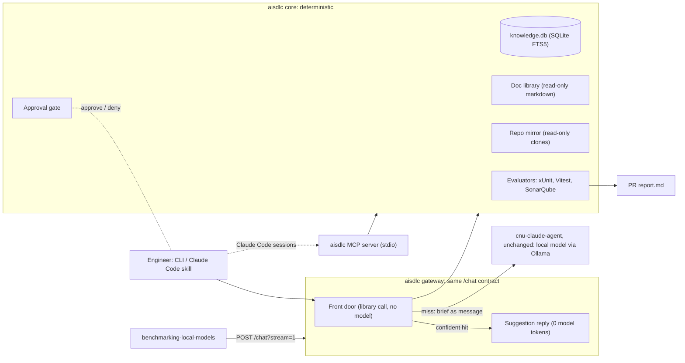
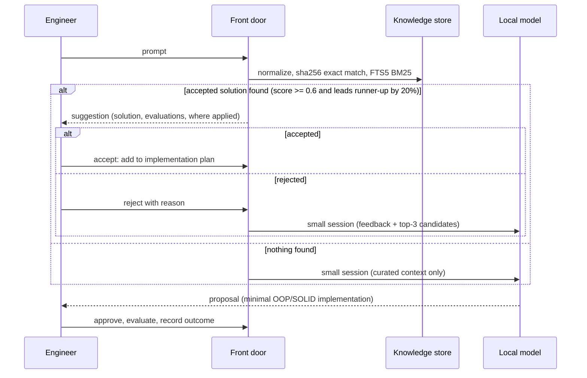
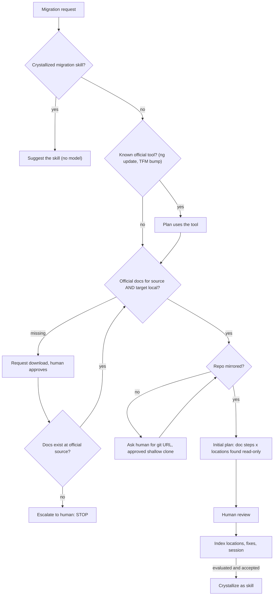
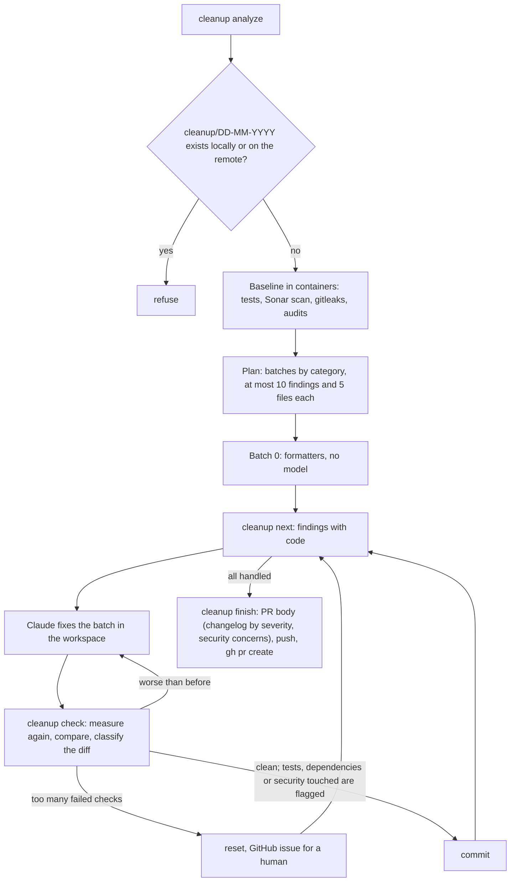

# Architecture

## Problem

The support benchmarks (`benchmarking-local-models`, Qwen3.8:27B behind cnu-claude-agent → Ollama) show that small
local models fail by **exploring**, not by lacking knowledge:

| Run 1793258147 (232 turns) | Value |
|---|---|
| Turns that hit the 600 s budget | 62, each with 13–58 tool calls |
| Tool calls on answered turns | 4.5 on average |
| Bash / Read calls over the run | 1201 / 559 |
| Turns that hit the 32k output limit | 21, some with 0 tool calls |

Both reports name the same cause: the model keeps searching instead of writing up what it already has.

So the work is shaped so the model **chooses and fills in**, and never **explores and writes freely**. The order is
always **determinism first, model second**.

## Shape

| Layer | Folder | Depends on |
|---|---|---|
| Domain: entities and rules, no I/O | `src/domain` | nothing |
| Ports: interfaces the use cases need | `src/ports` | domain |
| Use cases: one class per use case | `src/application` | ports, domain |
| Infrastructure: SQLite, HTTP, git, test runners | `src/infrastructure` | ports, domain |
| Adapters and composition root | `src/adapters` | everything |

The CLI, the MCP server, the front door and the chat gateway are adapters over **the same use cases**. MCP is one way
in, not the architecture. cnu-claude-agent is read-only for this work, so the gateway sits in front of it
([ADR 0007](adr/0007-chat-gateway-in-front-of-cnu-claude-agent.md)).

## Where the model is used

Only for:
1. a short clarification session with the engineer, when nothing approved matches or a suggestion was rejected;
2. drafting a minimal solution or a migration plan from retrieved, bounded context;
3. diagnosing a failed evaluation gate from its digest.

Everything else (lookup, ranking, downloads, clones, test runs, reports, migration preconditions) is code.

## Coding task flow

## Migration flow

In scope: JavaScript → TypeScript, and .NET version upgrades grounded in the official guides for the latest two
versions (.NET 9 and 10). The walking skeleton builds plan generation, not execution.

## Clean-up flow

The `aisdlc-cleanup` skill takes a repository to a pull request in small, checked batches
([ADR 0008](adr/0008-ephemeral-containers-for-gates.md), [ADR 0009](adr/0009-cleanup-gates-from-the-diff.md)).
It runs in **automode**: no approval on the way, because the engineer reviews the pull request. Each run has one
branch, `cleanup/DD-MM-YYYY`, locally and on the remote; a branch that already exists means the data was already
cleaned up or migrated, and `analyze` refuses.

Every step is reported to a **session**: `--session <name>` (Claude Code passes its own session name,
`aisdlc-cleanup-DD-MM-YYYY`), or `cleanup-<run_id>-DD-MM-YYYY`. Steps print live on the terminal that runs the
command and are appended to `work/sessions/<session>.jsonl`, which any listener can read; `aisdlc watch <session>`
follows it from another terminal.

Builds, tests and scans run in throw-away containers without network. Only restoring packages and the scanner
reach out, and they get the SonarQube token by name, never in an argument. Git, the push and `gh` stay on the host
with the engineer's own credentials.

## Agents, skills, MCP

See [ADR 0002](adr/0002-coarse-mcp-over-built-in-tools.md) and [ADR 0005](adr/0005-evaluator-subagents.md).

| Agent | Tools | When |
|---|---|---|
| main (coder) | the `aisdlc` MCP server only | clarification, minimal solution, migration plan |
| `gate-diagnoser` | `search_code`, `read_snippet`, `search_docs` | one per **failed** gate, in parallel; passing gates start nothing |

The gates themselves (xUnit, Vitest, SonarQube) run in parallel in one deterministic `run_evaluations` call, and the
PR report is a fixed template. Neither needs a model.

| Skill | For |
|---|---|
| `aisdlc-knowledge` | other engineers' Claude Code sessions: look up solutions, docs, where something was applied |
| `aisdlc-cleanup` | clean up a repository into a PR in automode, batch by batch; tests, dependency and security changes are flagged in the PR |
| `migrations/<from>-to-<to>` | crystallized migrations, written only after a human accepted an evaluated migration |

| MCP tool | Returns (bounded) |
|---|---|
| `find_solutions` | top 3: id, summary, score, evaluations, applications |
| `search_docs` | at most 5 chunks of at most 60 lines, with source URL |
| `search_code` | at most 5 hits |
| `read_snippet` | at most 40 lines |
| `request_approval` | an approval id; the model can ask, never decide |
| `propose_solution` | a draft solution id |
| `run_evaluations` | a combined digest of all gates |

## Security as code

- **Read-only context.** Docs live under `knowledge/docs`, clones under `mirrors/`. Every path from a tool is resolved
  and checked against its root (`PathGuard`). Writes go only to `work/`.
- **Downloads.** Only hosts on the allow-list in `config/sources.yaml`, and only after a human approved the request
  through the CLI.
- **Clones.** Only `git clone --depth 1 <https url>`, run with `execFile` (no shell), host on the allow-list, no
  credentials in the URL, and only after approval.
- **Secrets.** `SONAR_TOKEN` comes from the environment and is never logged or written to a report.
- **Approvals.** The model can create a request but no adapter it can reach can decide one. Only the CLI decides,
  and `approve` and `deny` need an interactive terminal and a confirmation, which an agent's tool call does not have.
- **Clean-up gates.** A repository's own code runs only in containers with no network, a read-only root and no
  capabilities. Which changes the PR reviewer must look at closely is decided from the diff, never by the model, and
  listed under Security concerns in the PR.

## Related documents

- [Entity model](entities.md)
- [ADRs](adr/)
- [cnu-claude-agent integration](integration-cnu-claude-agent.md)
