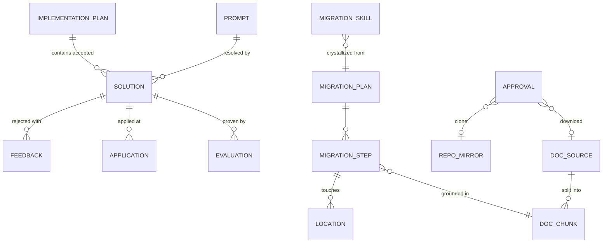
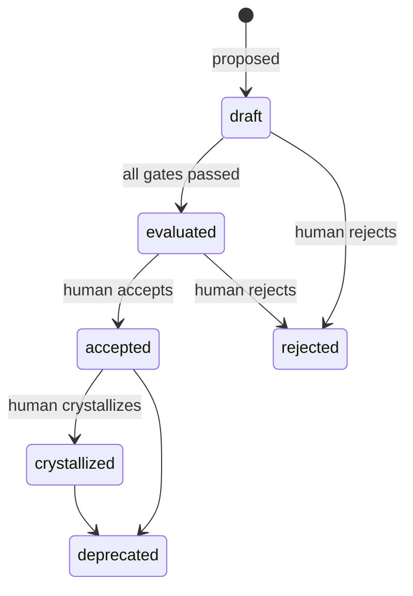

# Entity model

| Entity | Key fields | Why it exists |
|---|---|---|
| Prompt | `normalizedHash`, `text`, `normalizedText` | Exact match by hash, BM25 match on the normalized text. |
| Solution | `id`, `state`, `summary`, `diff` | Only `accepted` and `crystallized` solutions are ever suggested. |
| Evaluation | `kind` (xunit, vitest, sonar), `passed`, `digest` | Proof attached to a suggestion. The digest is capped at 1 KB so it fits in any context. |
| Application | `repository`, `commit`, `files`, `pullRequestUrl` | Where a solution has been applied. |
| Feedback | `reason`, `createdAt` | Why an engineer rejected a suggestion; the model session starts from it. |
| Implementation plan | `items` (solution ids) | What the engineer accepted for the work at hand. |
| DocSource / DocChunk | `id`, `url`, `framework`, `version`, `sha256`; chunk = one heading section | Grounded, read-only documentation. |
| RepoMirror | `name`, `url`, `path` | Read-only code context. |
| Approval | `id`, `kind` (download, clone, crystallize), `target`, `status`, `decidedBy` | The human gate. |
| MigrationPlan / Step / Location | `from`, `to`, steps with doc chunk and code locations | The initial migration plan. |
| MigrationSkill | `from`, `to`, `skillPath` | Checked before anything else when a migration is requested. |

## Solution lifecycle

The transitions are enforced in `Solution` itself (`src/domain/solution.ts`); an invalid transition throws.
