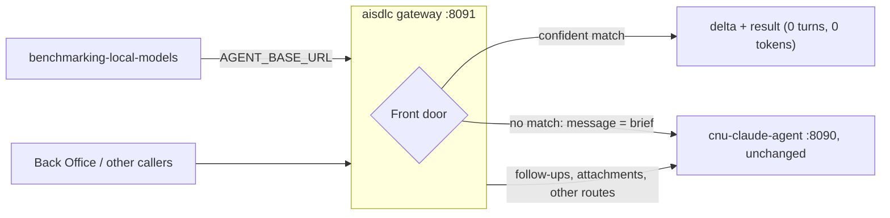

# Integrating with cnu-claude-agent

cnu-claude-agent stays the runtime and stays **unchanged**: that repository is read-only for this work. `aisdlc`
integrates from the outside, with a gateway that serves the same `POST /chat?stream=1` contract
([ADR 0007](adr/0007-chat-gateway-in-front-of-cnu-claude-agent.md)).



## Run it

```bash
npm run build
```
```bash
AISDLC_UPSTREAM_URL=http://localhost:8090 npm run gateway
```

| Variable | Default | Notes |
|---|---|---|
| `AISDLC_UPSTREAM_URL` | required | cnu-claude-agent's base URL |
| `AISDLC_GATEWAY_HOST` | `127.0.0.1` | keep it local unless something in front validates tokens |
| `AISDLC_GATEWAY_PORT` | `8091` | |
| `AISDLC_HOME` | this repository | the knowledge database the front door reads |

Point the benchmark at the gateway with `AGENT_BASE_URL=http://localhost:8091`. Compare runs with and without it;
`x-aisdlc-route` on each response says which path a message took.

## What works now, without changing cnu-claude-agent

| Goal | How |
|---|---|
| No model for known requests (ADR 0001) | the gateway answers from accepted solutions: `turns: 0`, `costUsd: 0`, `route: "front-door"` |
| Smaller context for the rest | the model starts from the short brief (task, rejection reason, top 3 candidates), not the raw message |
| Turn budget (ADR 0006) | the container's existing `CHAT_MAX_TURNS` setting (8 for coding runs) |
| Output budget (ADR 0006) | `CLAUDE_CODE_MAX_OUTPUT_TOKENS`, which the benchmark already sets per model (4096 for coding runs) |
| Knowledge for engineers | the `aisdlc` CLI, the MCP server and the [`aisdlc-knowledge` skill](../skills/aisdlc-knowledge/SKILL.md) in their own Claude Code |

## What needs cnu-claude-agent's owners

These are the parts of ADRs 0002, 0005 and 0006 that only work inside the agent. They are written down here so the
owners can decide; nothing in this repository depends on them.

1. **Replace the built-in tools with the `aisdlc` MCP server** (ADR 0002): register
   `node $AISDLC_HOME/dist/adapters/mcp/main.js` in `mcpServers` and disallow Bash, Read, Grep and Glob for a coding
   profile. This is the change that targets the 1201 Bash and 559 Read calls in run 1793258147. Keep the repository's
   existing rules: no `allowedTools`, `permissionMode: "default"`, `canUseTool` as the guard.
2. **Per-call tool budget** (ADR 0006): count calls in `canUseTool` and deny the 7th with "Budget reached. Write up
   what you have."
3. **`gate-diagnoser` sub-agent** (ADR 0005): tools `mcp__aisdlc__search_code`, `mcp__aisdlc__read_snippet`,
   `mcp__aisdlc__search_docs`; at most 4 tool calls and a 10-line answer.
4. **Token counts in the `result` event**: add the SDK result's `usage` (input, output and cache tokens), so the
   benchmark can measure all three goals instead of only turns, tool calls and latency.

## Mounts

| Path | Who writes | Why |
|---|---|---|
| `$AISDLC_HOME/knowledge` | the CLI only | knowledge database and docs; the gateway only reads it |
| `$AISDLC_HOME/mirrors` | the CLI, after an approved clone | read-only code context |
| `$AISDLC_HOME/work` | the CLI and MCP server | evaluation workspaces and reports |

Approvals are decided with the CLI by an engineer, never through the gateway or the MCP server.
